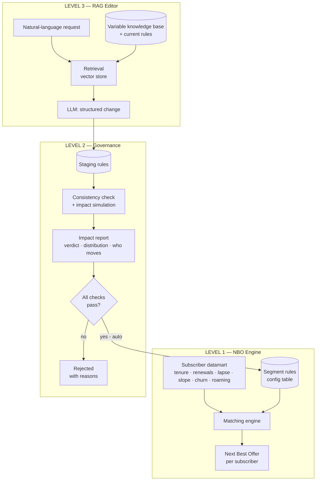
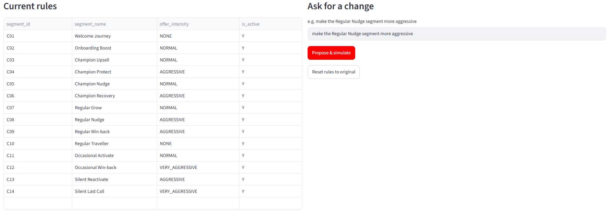
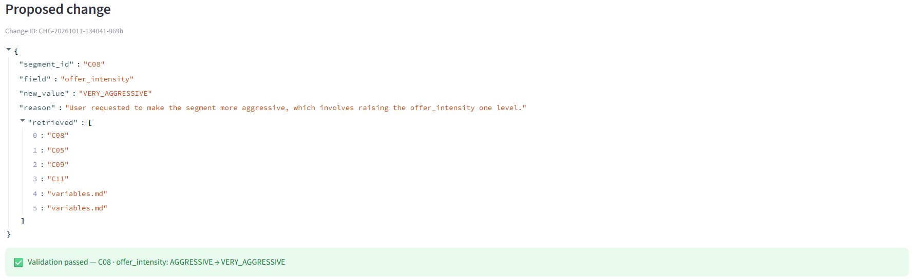
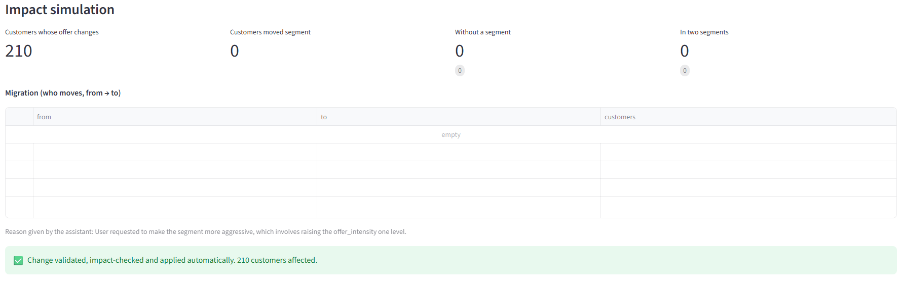
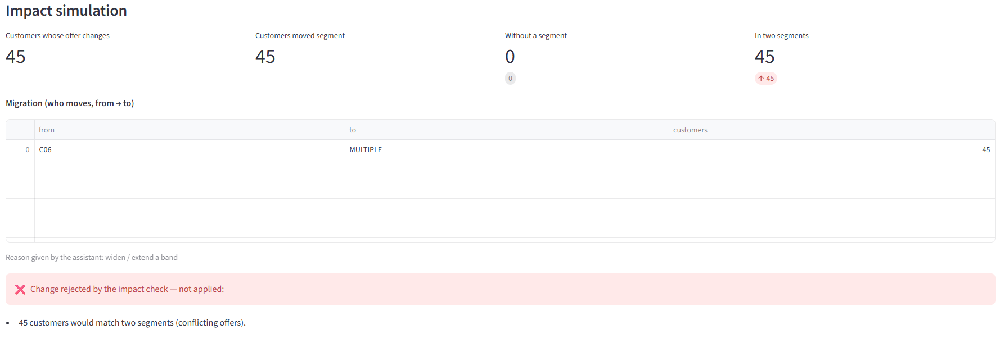
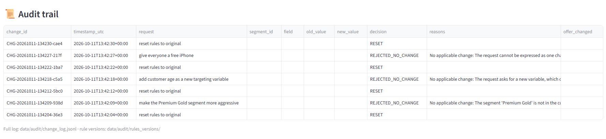

# 🎯 Config-Driven NBO Segmentation Engine — with RAG-Powered Rule Editing

> A **Next Best Offer (NBO)** engine for a prepaid telecom base: it assigns the
> right offer to the right subscriber, every day, from business-owned rules —
> and lets the business team **edit those rules in plain English** through a
> **Retrieval-Augmented Generation (RAG)** assistant, with impact simulation
> before anything goes live.

**100% synthetic data. No real operator data is used.**

`RAG` · `LLM` · `Data Engineering` · `Config-Driven Architecture` · `Oracle SQL` · `Streamlit`

---

## 💡 Why this project matters (the business problem)

A prepaid telecom operator has **millions of subscribers**. Each one should get
the **Next Best Offer** — the right bundle, at the right level of aggressiveness,
at the right moment in their lifecycle.

The old way: the targeting logic was **hard-coded**. Every time the marketing
team wanted to change a rule ("be more aggressive with lapsing loyal customers"),
it needed a **developer and a release**. Slow, risky, and the business had no
visibility on the impact before it hit production.

**This project removes the developer from the loop.** The business team owns the
rules, changes them in natural language, sees the impact on the full base
**before** applying, and ships — safely.

---

## 🧱 The solution, in three levels

```
LEVEL 1 — NBO Segmentation Engine        → the right offer per subscriber
LEVEL 2 — Self-Service Governance         → the business edits rules safely
LEVEL 3 — RAG Natural-Language Editor      → edit rules in plain English
```

Each level builds on the previous one. Together they turn a rigid, code-bound
pipeline into a **business-owned, AI-assisted decision system**.

---

## 🎁 Level 1 — How the Next Best Offer is implemented

The NBO is the **output of a daily matching** of every subscriber against a grid
of segments (14 in this portfolio version). The grid lives in a **table, not in code** — that is the key idea.

**Step 1 — Build the behavioural profile (datamart).**
For each subscriber, compute the variables that drive the offer:

| Variable | Meaning |
|---|---|
| **Tenure** | how long the line has been active |
| **Renewals (6M)** | main-bundle renewals in the last 180 days → loyalty level |
| **Lapse band** | how late the subscriber is on their bundle (Active → Slipping → Lapsed → Lost) |
| **Spend slope** | spending trend (up / flat / down) |
| **Churn band** | churn-model probability, banded Low / Med / High |
| **Roaming** | whether a late customer is simply travelling |

**Step 2 — Match against the rule grid (the engine).**
A subscriber lands in **exactly one** segment when all conditions hold:

```
tenure ∈ [min, max]  AND  renewals ∈ [min, max]  AND  lapse ∈ [min, max]
AND  roaming compatible  AND  risk (slope+churn) ∈ allowed combinations
→ assign segment  →  offer intensity (NONE / NORMAL / AGGRESSIVE / VERY_AGGRESSIVE)
```

**Step 3 — The Next Best Offer = the matched segment's offer.**
Example: a **Champion** (6+ renewals) who has **lapsed** (15+ days late)
→ segment "Champion Recovery" → **aggressive** win-back offer. A lapsed **Regular** who is **roaming** lands in "Regular Traveller" instead → **no offer**: they are travelling, not churning.
The grid encodes the full marketing strategy; the engine applies it to the whole
base, daily. Changing the strategy = changing a **row in the table**, not the code.

---

## 🛡️ Level 2 — Self-service governance (the business owns the rules)

Letting the business edit production rules directly is dangerous. So the change
goes through a safe pipeline:

```
Business edits a STAGING table  →  automatic consistency check + impact simulation
     → report (verdict + what changes)
     → if all checks pass → AUTOMATIC update to production  (else rejected with the reasons)
```

What the business can do on their own — **no developer, no release**:
- change limits (bounds), activate/deactivate a segment, add a new segment.

What the system guarantees:
- **Guardrails at edit time** (constraints reject invalid values on the spot).
- **Consistency checks** (gaps, overlaps, bad risk combinations).
- **Impact simulation** — before applying, it shows the new distribution and
  **how many customers move**, segment by segment.
- **Applied automatically once all checks pass** — and **rejected, never applied**, if any check fails.

The impact report answers the question every marketer asks:
> *"If I change this rule, who moves — and where?"*

---

## 🧠 Level 3 — RAG: editing the rules in plain English

This is where Retrieval-Augmented Generation comes in. The business shouldn't
need to know column names or SQL. They should just say what they want.

```
User:  "make the Regular Nudge segment more aggressive"
  → RAG RETRIEVES : the current rules + the variable knowledge base (vector store)
  → LLM GENERATES : a grounded, structured change
                    { "segment_id": "C08", "field": "offer_intensity",
                      "new_value": "VERY_AGGRESSIVE" }
  → VALIDATED + IMPACT-SIMULATED  (reuses Level 2)
  → if valid → applied AUTOMATICALLY ; if not → rejected with the reason
```

**Why this is genuine RAG** — the LLM does **not** know the rules. For every
request it first **retrieves** the relevant context (current rules + variable
docs) from a vector store, then **generates** a change grounded in that context.
*Retrieve → generate → ground.* And crucially, the AI **never touches the data
directly**: it only proposes a change that the deterministic Level-2 pipeline
validates and simulates before applying it automatically. **AI proposes; the system verifies, then applies.**

---

## 🏗️ Architecture



---

## 🎬 Demo

**1 — The business types a request in plain English** (left: the 14 segments and their current offer)



**2 — The RAG assistant proposes a structured change, the engine validates it**



**3 — Impact simulated on the 6,000 subscribers, then applied automatically**



**A change that would put customers in two segments is rejected**
("extend the Champion Nudge window to 20 days late" → 45 customers would get conflicting offers)



**Every request, applied or rejected, is logged** (`data/audit/change_log.jsonl` + rule versions before/after)



All captures: [`screenshots/`](screenshots/) · Slide deck (30 slides, speaker notes): [`presentation/NBO_Segment_Editor_RAG.pptx`](presentation/NBO_Segment_Editor_RAG.pptx)

---

## 🔌 Final step — Production integration with Oracle *(planned)*

In this portfolio version the rules live in local files. In production, the
final step plugs the app into the Oracle database that drives the offers:

```
Business user → Streamlit app (RAG + guardrails + impact simulation)
   → approved change → Oracle STAGING table (change requests)
   → PL/SQL apply procedure: re-check + version + apply, in one transaction
   → Oracle CONFIG table (rule grid) → daily NBO batch → new offers
```

The app never writes the production grid directly: it only inserts approved
requests, and the database re-checks them before applying. The full plan —
tables, apply procedure, security, rollback — is in
[docs/oracle_integration_plan.md](docs/oracle_integration_plan.md).
*Not implemented in this repository: no Oracle code or credentials are included.*

---

## 🛠️ Tech stack
- **Python**, **LangChain**
- **OpenAI** — `text-embedding-3-small` (embeddings) + `gpt-4o-mini` (generation)
- **Chroma** — local vector store
- **Streamlit** — UI
- **Pandas / SQL** — rule store + impact simulation
- *(Production original built on Oracle SQL / PL/SQL; this portfolio version is self-contained and synthetic.)*

## 📂 Project structure
```
nbo-rag-segment-editor/
├── data/          synthetic data + generator (rules, subscribers)
│   └── audit/     change log (every request) + rule versions (before/after)
├── docs/          variable knowledge base (indexed by RAG) + Oracle integration plan
├── rag/           engine (NBO + guardrails), ingestion, RAG chain, audit, settings
├── app/           Streamlit interface
├── tools/         automated screenshots (Playwright) + crops for slides
├── screenshots/   captures of every demo step
├── presentation/  slide deck (PowerPoint, with speaker notes)
└── README.md
```

## 🚀 Getting started
```bash
pip install -r requirements.txt
# put OPENAI_API_KEY=sk-... in a .env file at the project root (git-ignored, never commit it)
python data/generate_synthetic_data.py # build synthetic data
python rag/ingest.py                   # build the vector store
streamlit run app/main.py              # launch the editor
```

## 🎓 Skills demonstrated
**AI / RAG** — embeddings, vector store, retrieval, constrained LLM structured output, guardrails for AI-driven changes.
**Data engineering** — behavioural datamart, config-driven rules engine, daily batch design.
**Governance & product thinking** — staging → check → impact simulation → controlled promotion, business self-service.

---
*Portfolio project — synthetic data only. Inspired by a real Next Best Offer
system built for a telecom operator; all data, schema and business values here
are fictional.*
